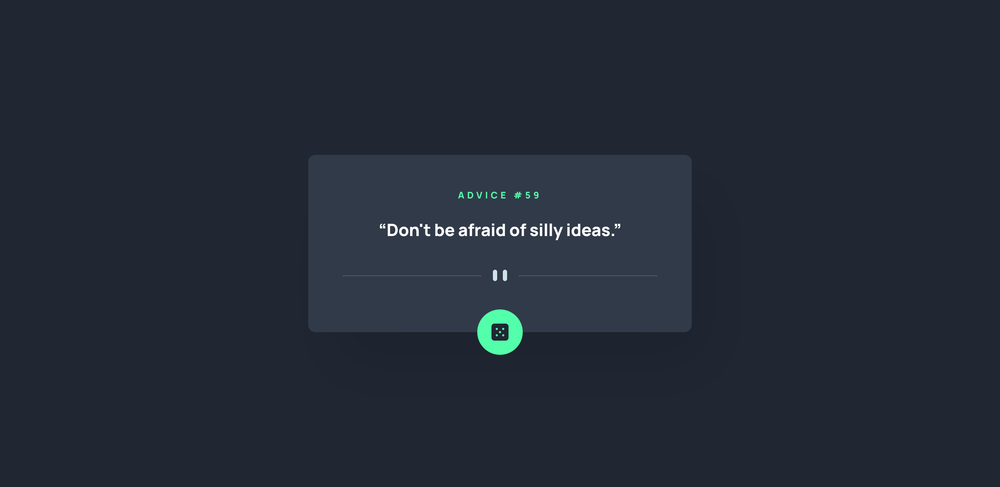

# Frontend Mentor - Advice generator app solution

This is a solution to
the [Advice generator app challenge on Frontend Mentor](https://www.frontendmentor.io/challenges/advice-generator-app-QdUG-13db).
Frontend Mentor challenges help you improve your coding skills by building realistic projects.

## Table of contents

- [Overview](#overview)
  - [The challenge](#the-challenge)
  - [Screenshot](#screenshot)
  - [Links](#links)
- [My process](#my-process)
  - [Built with](#built-with)
  - [What I learned](#what-i-learned)
  - [Continued development](#continued-development)
  - [Useful resources](#useful-resources)
  - [AI Collaboration](#ai-collaboration)
- [Author](#author)

## Overview

### The challenge

Users should be able to:

- View the optimal layout for the app depending on their device's screen size
- See hover states for all interactive elements on the page
- Generate a new piece of advice by clicking the dice icon

### Screenshot



### Links

- Solution URL: [GitHub Repo](https://github.com/runny-life/advice-generator-app)
- Live Site URL: [GitHub Pages](https://runny-life.github.io/advice-generator-app/)

## My process

### Built with

- Semantic HTML5 markup
- CSS custom properties
- CSS Modules
- Flexbox
- Responsive sizing with `clamp()` and the `<picture>` element
- [React](https://react.dev/) - JS library
- [Vite](https://vite.dev/) - Build tool
- [Advice Slip API](https://api.adviceslip.com/) - Source of the advice
- ESLint, Prettier, Husky and lint-staged - Code quality and pre-commit checks

### What I learned

**Fetching data in an effect, with cancellation.** The first request is sent when the component mounts. An
`AbortController` cancels it if the component unmounts (this also keeps React StrictMode from leaving a duplicate
request behind), and the `AbortError` is ignored so it doesn't show up as a real error:

```jsx
const getAdvice = useCallback((signal) => {
  fetch(API_URL, { signal })
    .then((res) => {
      if (!res.ok) throw new Error(`HTTP ${res.status}`);
      return res.json();
    })
    .then((data) => setAdvice(data.slip))
    .catch((error) => {
      if (error.name !== 'AbortError') setError(error.message);
    })
    .finally(() => {
      if (!signal?.aborted) setLoading(false);
    });
}, []);

useEffect(() => {
  const controller = new AbortController();
  getAdvice(controller.signal);

  return () => controller.abort();
}, [getAdvice]);
```

Two things I took away from this:

- `fetch` doesn't reject on 404 or 500, so the `res.ok` check is needed to treat those as errors.
- The `react-hooks/set-state-in-effect` lint rule complains about calling `setState` synchronously inside an effect.
  Resetting `loading` and `error` in the click handler instead (an event, not an effect) keeps the effect clean.

**Keeping the UI stable while loading.** My first version rendered the card only when `!loading`, so the whole card
(including the dice button) disappeared on every click, and `disabled={loading}` never had any effect. Now the card is
always mounted: the old advice stays visible while the new one loads, the button is disabled, and an error still leaves
the button available for another try.

**Responsive divider with `<picture>`.** The mobile and desktop dividers are different images, so the browser picks the
right one without any JavaScript:

```jsx
<picture>
  <source srcSet={dividerDesktop} media="(min-width: 768px)" />
  
</picture>
```

**Accessibility details.** The icon-only button has an `aria-label`, the decorative images have an empty `alt`, and the
advice text sits in an `aria-live="polite"` region so screen readers announce new advice.

### Continued development

- Move the fetching logic into a custom `useAdvice` hook, or use a data-fetching library such as TanStack Query instead
  of handling loading and error state by hand.
- Add tests for the loading, success and error states.
- Improve the error state, for example with a dedicated retry message.

### Useful resources

- [You Might Not Need an Effect](https://react.dev/learn/you-might-not-need-an-effect) - Explained why the linter
  complains about `setState` in effects and when an effect is the right tool.
- [AbortController on MDN](https://developer.mozilla.org/en-US/docs/Web/API/AbortController) - Helped me understand how
  to cancel a `fetch` request.
- [Advice Slip API](https://api.adviceslip.com/) - API documentation. Responses are cached for a couple of seconds, so
  very fast clicks can return the same advice.

### AI Collaboration

I used Claude as a learning assistant while building this project.

- **How I used it:** to explain concepts such as `useEffect`, `AbortController` and error handling with `fetch`, to help
  fix an ESLint error, and to review my finished code.
- **What worked well:** the code review caught a real bug (the card and button disappearing on every click), and the
  step-by-step explanations helped me understand why the fixes worked rather than just copying them.
- **What didn't:** the first two suggested fixes for the `set-state-in-effect` lint error didn't satisfy the linter. I
  ended up with my own version based on `fetch` callbacks and `AbortController`, which was a good reminder to test
  suggestions instead of trusting them blindly.

## Author

- Frontend Mentor - [@runny-life](https://www.frontendmentor.io/profile/runny-life)
- GitHub - [@yourusername](https://github.com/runny-life)
